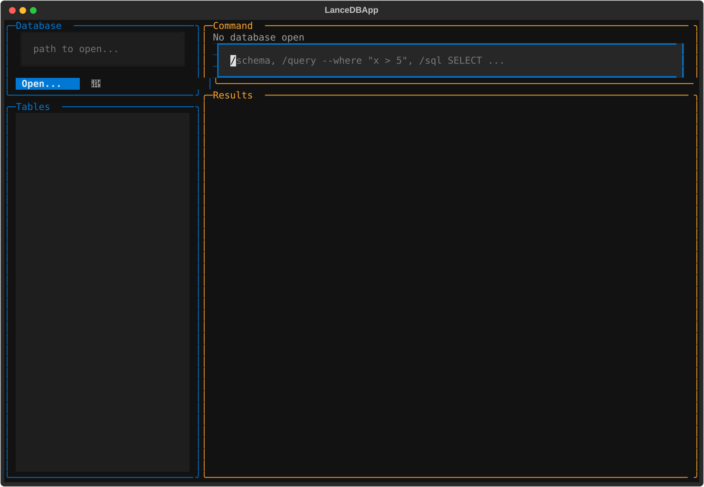
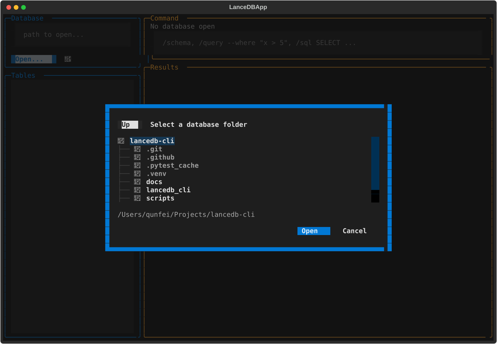
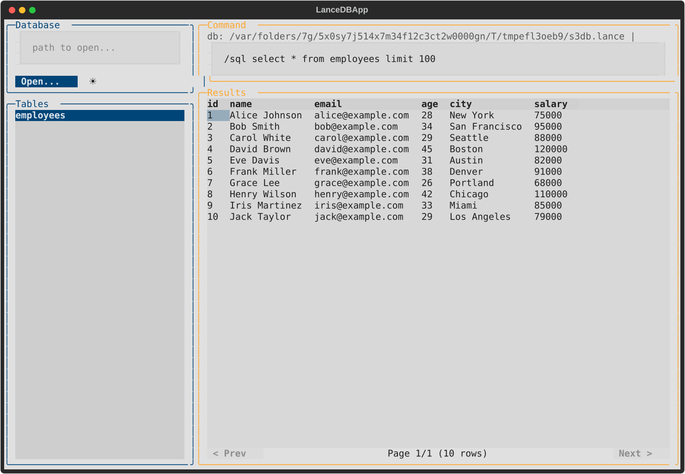
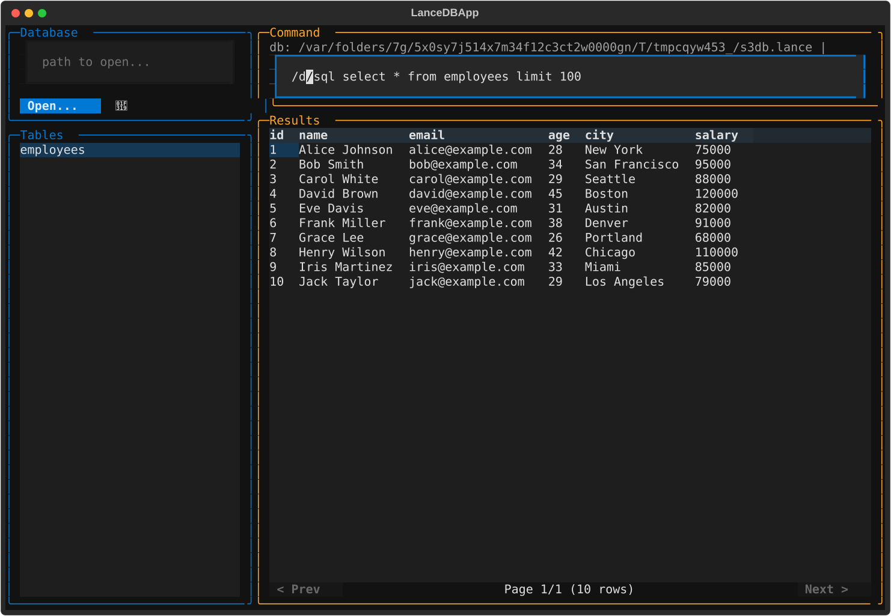
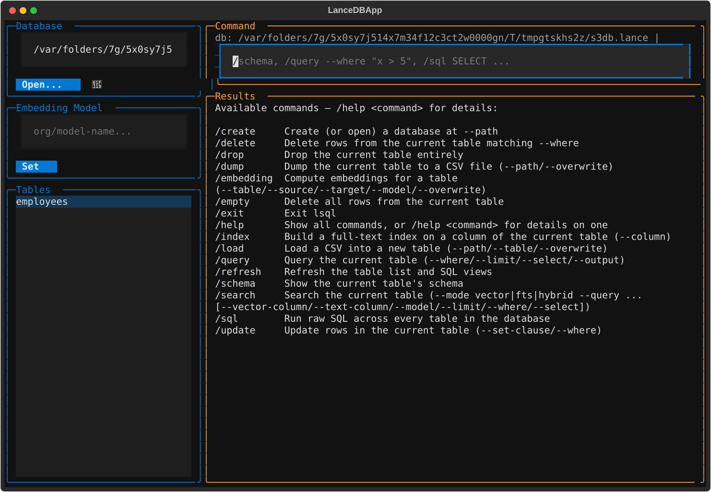
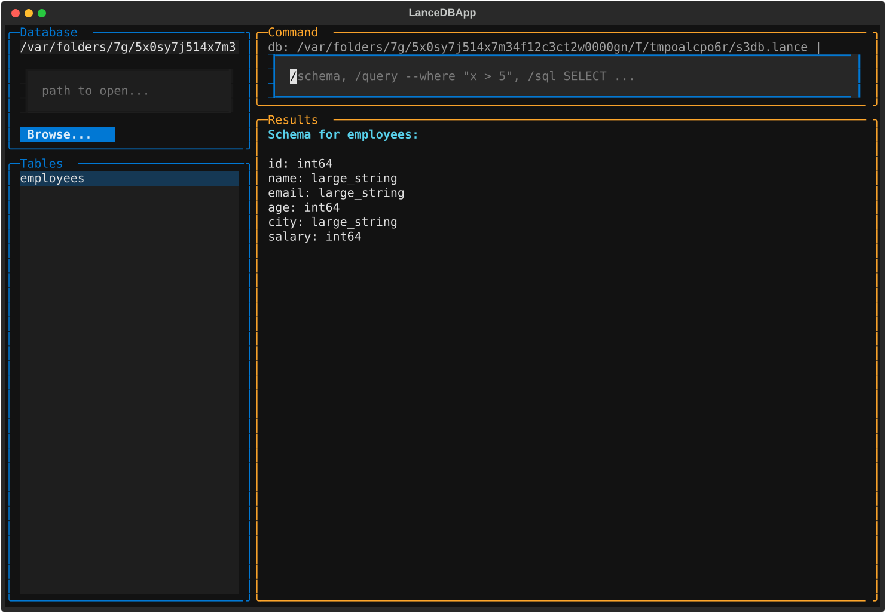
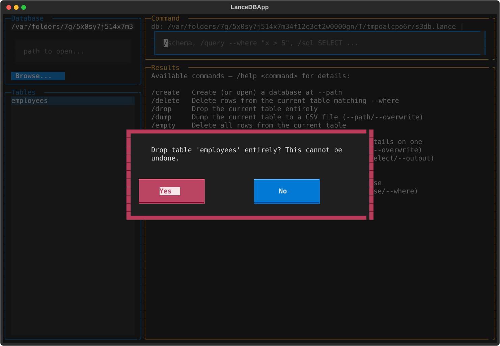
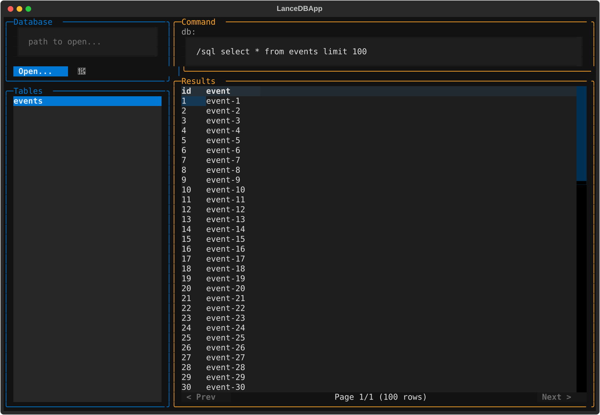
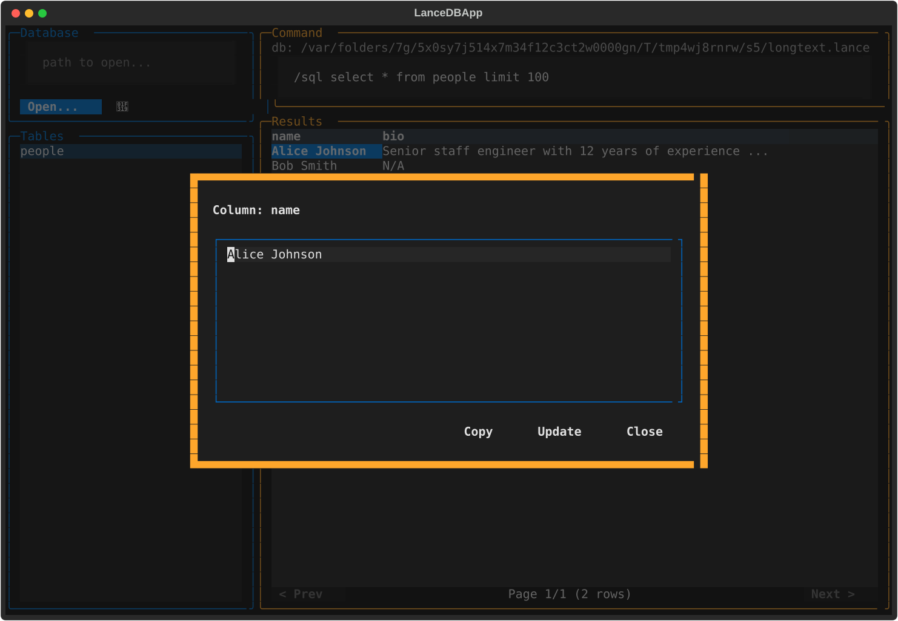

# 🗄️ lsql

**lsql** is a terminal GUI for browsing and managing [LanceDB](https://lancedb.com/)
databases. Pick a database and a table visually,
then run slash commands against whatever's selected — no more retyping paths and table
names for every single query.



---

## ✨ Features

- 🖥️ **Four-panel layout** — database picker, table list, command input, and results,
  all on one screen
- 📁 **Folder-browser dialog** — open an existing database by browsing to it, no need
  to memorize or hand-type paths
- ⚡ **Slash commands with auto-suggestion** — type `/` and see every available command,
  filtered live as you type
- 🖱️ **Click a table to preview it** — instantly runs `select * from <table> limit 100`
  for you
- 🔍 **Double-click any cell** — pop open the full, untruncated value when a row is too
  wide to read comfortably, with buttons to **copy** it or **edit and write it back**
- 📄 **Pagination** — large result sets are paged 100 rows at a time instead of flooding
  the screen
- 🧮 **Raw SQL via DuckDB** — `/sql` runs across every table in the database
- 🛟 **Confirmation dialogs** — `/drop`, `/empty`, and `/delete` always ask first
- ⏪ **Command history** — up/down arrow recall, just like a shell
- 📚 **Built-in help** — `/help` lists every command; `/help <command>` shows its flags
- 🌓 **Light/dark theme** — a one-click toggle, defaulting to your OS's current setting

---

## 📦 Installation

```bash
pip install lsql
```

## 🚀 Quick Start

```bash
lsql                      # launch the TUI
lsql /path/to/database    # launch pre-connected to a database
```

---

## 🧭 A tour of the four panels

### 1️⃣ Database — type a path or browse to one

Type a path directly and hit Enter, or click **Open...** to pick a folder visually (with
an **Up** button to walk back up the directory tree). The 🌙/☀️ icon next to it toggles
light/dark theme — it defaults to whatever your OS is currently using.



Opening a path that doesn't exist yet creates a database there — same as running
`/create --path <path>`.

### 2️⃣ Tables — click to preview

Click any table in the list to select it and immediately see its first 100 rows.



### 3️⃣ Command input — slash commands with live suggestions

Start typing `/` and a filtered dropdown of matching commands appears. Use `↑`/`↓` to
pick one, `Tab` or `Enter` to accept it, `Esc` to dismiss. `↑`/`↓` also recall previous
commands when the dropdown isn't open.



Forgot a flag? `/help` lists every command, and `/help <command>` shows its full usage:



### 4️⃣ Results — tables, schemas, and safety checks

`/schema` renders a table's columns and types right in the results panel:



Destructive commands always confirm first:



Large results are paginated — 100 rows per page, with `< Prev` / `Next >` controls:



And if a cell's value is too long to read in the table, double-click it to see the full
text, copy it, or edit it and write the change back to the table:



---

## ⌨️ Command reference

Commands that operate on a table (`query`, `schema`, `delete`, `empty`, `drop`, `update`,
`dump`) always act on whichever table is currently selected in the table list — select
it there rather than naming it in the command.

| Command | What it does |
|---|---|
| `/create --path <path>` | Create (or open) a database at `path` |
| `/query [--where ...] [--limit 10] [--select "a,b"] [--output table\|json]` | Query the current table |
| `/schema` | Show the current table's schema |
| `/sql <SQL query>` | Raw SQL across **every** table — the one command that ignores the table selection |
| `/update --set-clause "col='val'" --where "..."` | Update rows in the current table |
| `/delete --where "..."` | Delete rows from the current table |
| `/empty` | Delete all rows from the current table |
| `/drop` | Drop the current table entirely |
| `/load --path file.csv --table name [--overwrite]` | Load a CSV into a new table |
| `/dump --path out.csv [--overwrite]` | Dump the current table to CSV |
| `/refresh` | Refresh the table list and SQL views |
| `/help [command]` | Show all commands, or details for one |
| `/exit` | Quit |

`/drop`, `/empty`, and `/delete` pop a confirmation dialog before running. `/load`
creates a brand-new table, so it takes an explicit `--table` name instead of using the
current selection.

---

## 🛠️ Development

```bash
git clone https://github.com/wuqunfei/lsql.git
cd lsql
pip install -e ".[dev]"
```

Run the tests:

```bash
pytest
```

Regenerate the screenshots above after a visible UI change:

```bash
python scripts/generate_screenshots.py
```

### Requirements

- Python 3.9+
- lancedb, duckdb, pandas, typer, rich, textual

---

## 🤝 Contributing

Contributions are welcome! Please feel free to open a PR.

## 🐛 Issues

Found a bug or have an idea? [Open an issue](https://github.com/wuqunfei/lsql/issues).

## 📄 License

Apache License 2.0 — see [LICENSE](LICENSE) for details.
